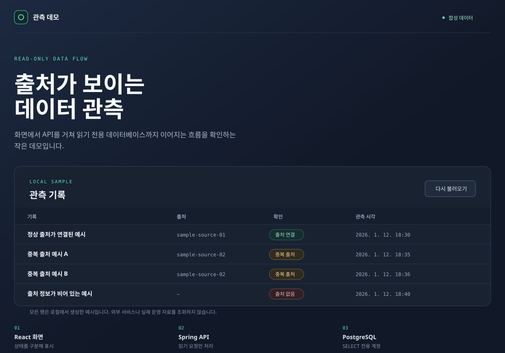
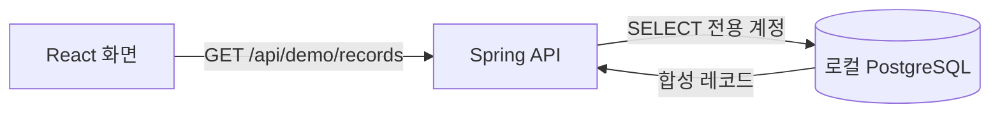

# 읽기 전용 관측 데모

합성 레코드를 조회해 **React 화면 → Spring API → 읽기 전용 PostgreSQL** 흐름을 보여주는 독립 데모입니다. 개인 프로젝트 구현을 바탕으로 민감 요소와 원본 이력을 제외해 다시 구성했습니다. 원본 저장소 전체를 공개한 것이 아닙니다.



화면의 행과 출처 표시는 모두 로컬 합성 자료입니다. 실제 StratDock, 투자 전략, 계좌, 주문, 시세 또는 운영 데이터에 연결하지 않습니다.

## 확인할 수 있는 기능

- 정상·중복·출처 누락 기록을 각각 구분해 표시
- 연결 오류와 자료 없음 상태를 따로 표시
- 새로 고침으로 API에서 자료를 다시 조회
- 데이터베이스 계정은 읽기 전용 권한만 보유

## 구성



## 설계 선택

- 원본 데이터 계약을 옮기지 않고 `demo_record`라는 최소 합성 테이블을 새로 정의했습니다. 원본 호환성은 제공하지 않지만, 내부 스키마와 도메인 규칙 없이 API와 화면의 출처 처리 흐름을 확인할 수 있습니다.
- 메모리 fixture 대신 로컬 PostgreSQL과 `SELECT` 전용 계정을 사용합니다. 실제 권한 경계를 검증할 수 있고, 실행에는 Docker가 필요합니다.
- 데이터 없음은 빈 목록으로, 연결 실패는 HTTP 503으로 반환합니다. 연결 상태를 정상으로 추정하지 않습니다.

## 로컬 실행

필요 환경: JDK 25, Maven, Node.js 22 이상, Docker Compose.

1. 저장소 루트에서 `.env.example`을 `.env`로 복사하고 두 값을 로컬 전용 비밀번호로 바꿉니다. 이 파일은 Git에서 제외됩니다.
2. 합성 DB를 시작합니다.

   ```bash
   docker compose up -d demo-db
   ```

3. API를 시작합니다. Windows PowerShell은 `scripts/run-api.ps1`, macOS/Linux는 `sh scripts/run-api.sh`를 실행합니다.
4. 별도 터미널에서 화면을 시작합니다.

   ```bash
   cd web
   npm ci
   npm run dev
   ```

5. 브라우저에서 `http://127.0.0.1:5173`을 엽니다.

화면은 `http://127.0.0.1:8080`의 API로 요청을 전달합니다. API는 기본적으로 `127.0.0.1:8080`, DB는 기본 `127.0.0.1:55432`에만 바인딩됩니다. 포트가 이미 사용 중이면 `.env`의 `DEMO_DB_PORT`와 `DEMO_SOURCE_URL`을 같은 다른 로컬 포트로 바꿉니다. DB 초기화 시 별도의 `demo_reader` 계정에 `SELECT`만 허용합니다. 예시 비밀번호를 실제 서비스에 재사용하지 마세요.

## 검증

```bash
mvn verify
cd web
npm ci
npm run verify
```

백엔드 검증은 Testcontainers로 임시 PostgreSQL을 실행해 정상·중복·출처 누락 자료와 쓰기 거부를 확인합니다. 화면 테스트는 정상 자료, 빈 결과, 연결 오류 표시를 확인합니다.

## 범위와 한계

- 모든 데이터는 데모를 위해 만든 합성 값입니다.
- 이 저장소는 읽기 전용 화면과 API 경계만 보여줍니다. 실제 운영 연동, 데이터의 진위, 비즈니스 의미 또는 성과를 검증하지 않습니다.
- 출처 값은 예시 문자열이며 실제 자료를 가리키지 않습니다.
- 이 공개 데모에는 원본 Git 이력, 내부 이슈·PR 기록, 실제 운영 계약이 포함되지 않습니다.
